<h2>Hi, I'm Hemaka Wanshanath </h2>

Information Systems Undergraduate @ UCSC

---

## About

I'm an Information Systems undergraduate at the University of Colombo School of Computing, currently exploring cloud computing, DevOps, and modern infrastructure technologies.

I enjoy learning through practical projects while building a broader foundation across software development, networking, databases, and systems.

---

## Key Projects

- **[LiteCode](https://github.com/Supu-cloud/Lite-Code---IS2205-MAD-mini-project)**  
  *Mobile Application Development Project* — A collaborative Android application developed for the **IS2205 Mobile Application Design and Development** module at UCSC.  
  `Kotlin` · `Android Studio` · `HTML` · `CSS` · `JavaScript`
  
---
## Technologies & Tools I've Worked With

| Area | Technologies |
|---|---|
| **Programming** | C, C++, Python |
| **Web** | HTML, CSS, JavaScript, PHP |
| **Database** | MySQL |
| **Mobile** | Kotlin, Flutter, Android Studio |
| **Cloud & Systems** | AWS, Azure, Linux |
| **Tools & Automation** | Git, GitHub, GitHub Actions |

### Currently Learning

Cloud Computing · DevOps · Linux · Networking · Docker · Kubernetes · Terraform

---

## Credentials

- Cloud Computing Fundamentals — IBM
- Fundamentals of Machine Learning and Artificial Intelligence — AWS
- Linux Unhatched — Cisco
- Generative AI Overview for Project Managers — PMI
- Problem Solving (Basic) — HackerRank

---

## GitHub Activity

  

---

## Connect

Feel free to connect with me or reach out.

